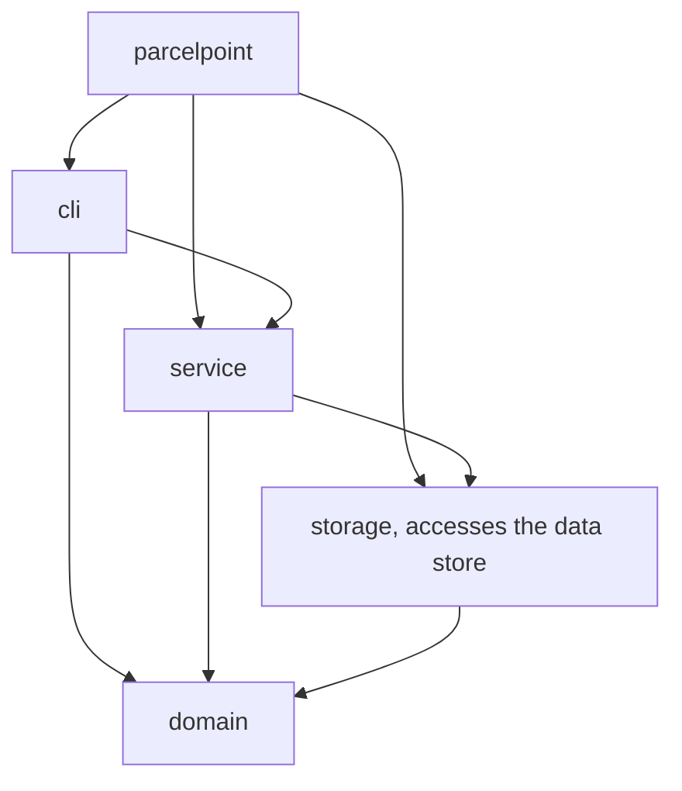
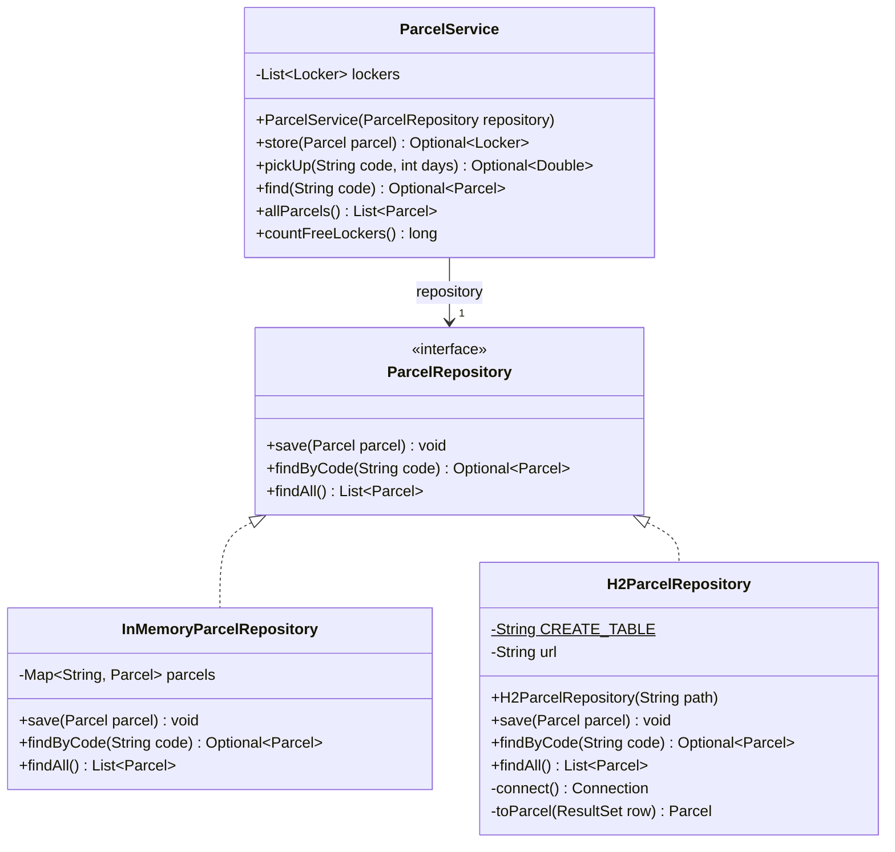
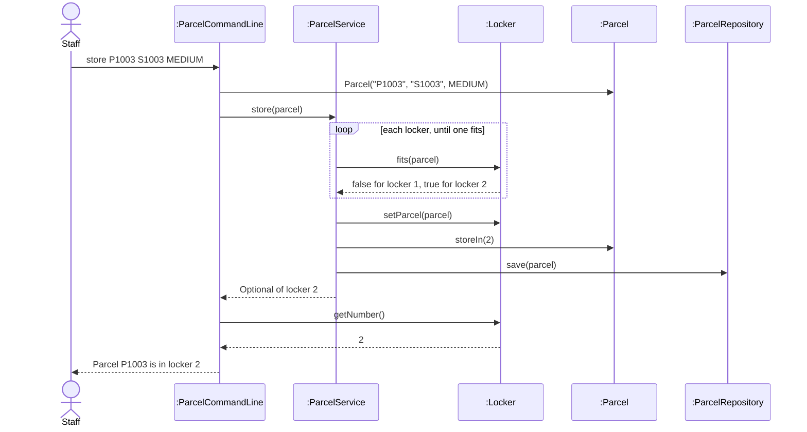

# Lab Report, Designing the Data Management Layer with H2

Repository URL: https://github.com/JirathiwatSun/itcs382-h2-lab

## Tools

| Item | Version or name |
| --- | --- |
| JDK | OpenJDK 25.0.5 (Microsoft build) from `java -version`; Maven runs on Oracle JDK 23.0.1 |
| Maven | Apache Maven 3.10.0 |
| IDE | Cursor 3.29.9 (based on Visual Studio Code) |
| AI tool and exact model, if you used one | Cursor Agent, Claude Opus 5.5 |

## Part 0. From a store in memory to H2

Commit of the starter, before any change: 4199011

0.3 Your prediction for `staff`, written before the second run:

`staff` will list no parcels and show `Free lockers: 3`, because Main uses InMemoryParcelRepository, which keeps the parcels only in a Java map.

Output of the second run, for `staff` and `quit`:

```text
> staff
Free lockers: 3
> quit
```

State in one sentence where you think the parcels of the first run were kept.

They were kept only in the memory of the running program, in the `LinkedHashMap` field of InMemoryParcelRepository, so they were lost when the first run ended and its memory was freed.

0.5 The line of Main that you would change to keep the parcels somewhere else:

```java
ParcelRepository repository = new InMemoryParcelRepository();
```

0.6 Commit of the switch to H2: a64f3f6

0.7 Output of `SELECT * FROM PARCEL;` after you stored two parcels:

```text
sql> SELECT * FROM PARCEL;
CODE  | STUDENT_ID | PARCEL_SIZE | STATUS | LOCKER_NUMBER
P1001 | S1001      | SMALL       | STORED | 1
P1002 | S1002      | LARGE       | STORED | 3
(2 rows, 14 ms)
```

0.8 Explain why ParcelPoint could not start while the H2 Shell was open, and identify the class that wrote the message `Cannot create the PARCEL table`.

H2 is embedded, so the database belongs to the process that opened it. While the H2 Shell had `data/parcelpoint.mv.db` open, H2 locked the file. When ParcelPoint tried to connect, H2 refused with `Database may be already in use`, caused by `The file is locked`. The first line came from ParcelPoint, not from H2: the constructor of `H2ParcelRepository` (stack trace `H2ParcelRepository.<init>(H2ParcelRepository.java:36)`, called from `Main.main`) caught the `SQLException` and wrapped it in an `IllegalStateException` with the message `Cannot create the PARCEL table`.

0.9 Explain why `staff` shows no parcel while `find` shows each one, and why all three lockers look free.

`find` uses `findByCode`, which really runs `SELECT * FROM PARCEL WHERE CODE = ?` and maps the row with `toParcel`. `staff` uses `ParcelService.allParcels()`, which calls `findAll`, and the starter `findAll` was a stub that returned `List.of()` without reading the database, so the list was empty. The lockers are not stored in the database. ParcelService creates its three Locker objects fresh in memory on every start, and its constructor refills them by putting every waiting parcel from `findAll()` back into its locker. Because `findAll()` returned nothing, no locker was refilled, so all three looked free even though P1001 and P1002 were stored in lockers 1 and 3. In Step 0.6 `staff` showed one free locker only because `store` had filled the lockers in memory during that same run.

0.11 Your findAll method:

```java
@Override
public List<Parcel> findAll() {
    String sql = "SELECT * FROM PARCEL ORDER BY CODE";
    List<Parcel> parcels = new ArrayList<>();
    try (Connection connection = connect();
         PreparedStatement statement = connection.prepareStatement(sql);
         ResultSet row = statement.executeQuery()) {
        while (row.next()) {
            parcels.add(toParcel(row));
        }
    } catch (SQLException e) {
        throw new IllegalStateException("Cannot read the parcels", e);
    }
    return parcels;
}
```

Commit that adds findAll: fb8fb10

0.12 Output of `SELECT * FROM PARCEL;` after the pickup:

```text
sql> SELECT * FROM PARCEL;
CODE  | STUDENT_ID | PARCEL_SIZE | STATUS    | LOCKER_NUMBER
P1001 | S1001      | SMALL       | PICKED_UP | null
P1002 | S1002      | LARGE       | STORED    | 3
(2 rows, 9 ms)
```

0.13 Optional. Describe what `find P9999'OR'1'='1` showed while the SQL was joined from strings, and what it showed after you put the placeholder back.

With the SQL joined from strings, `find P9999` printed `No parcel with code P9999`, but `find P9999'OR'1'='1` printed `P1001, S1001, SMALL, PICKED_UP`. The typed quotes closed the text in the SQL, so H2 ran `SELECT * FROM PARCEL WHERE CODE = 'P9999'OR'1'='1'`. The condition `'1'='1'` is true for every row, so the query returned all rows, and `findByCode` showed the first one. This is SQL injection. After I put the `?` placeholder and `statement.setString(1, code)` back, the same command printed `No parcel with code P9999'OR'1'='1`, because H2 compared CODE with the whole typed text as a single value.

## Part A. Model the design

A1 Complete the flowchart with one node for each package and one arrow for each dependency, from the package that uses to the package that is used. Mark the package that accesses the data store.



State whether cli depends on storage, and explain why.

No, cli does not depend on storage. No class in cli imports anything from `parcelpoint.storage`. ParcelCommandLine talks only to ParcelService and to domain objects, and ParcelService is the only class that uses the repository. Main is the one class above service that names storage, because it creates the concrete repository and injects it into ParcelService. So the presentation layer is shielded from the data management layer, and changing the data store cannot affect cli.

A2 Complete the class diagram of the data management layer with ParcelService, the interface ParcelRepository with its three operations, and the two classes that implement it.



A3 Draw a sequence diagram for the command `store P1003 S1003 MEDIUM`, from the staff member to the repository. Show each message as an operation of the class that receives it.



Explain why the last lifeline is the interface ParcelRepository rather than H2ParcelRepository.

ParcelService sends `save` through its field `repository`, whose type is the interface ParcelRepository, and its code never names H2ParcelRepository. The diagram shows the object as the sender sees it. At run time the object is the H2ParcelRepository that Main injected, but the same interaction holds unchanged for InMemoryParcelRepository, which is the point of the Dependency Inversion Principle. The interface is the boundary of the data management layer, so JDBC and SQL details stay below it and out of this design.

## Part B. Design questions

1. Identify the files that you changed to move from the store in memory to H2, and explain why no other class had to change. Use the terms of this course.

To switch the store I changed only `Main.java`, two lines: the import and `new H2ParcelRepository("./data/parcelpoint")`. To finish the H2 repository I also changed `H2ParcelRepository.java` (`findAll`), and `pom.xml` already listed H2. No other class changed because ParcelService depends on the abstraction ParcelRepository, not on a concrete class (Dependency Inversion Principle), and it receives the repository through constructor injection from Main, which is the one place that chooses the implementation. The JDBC and SQL details are hidden inside H2ParcelRepository (information hiding), both implementations honour the same contract (Liskov Substitution Principle), and adding a store means adding a class rather than modifying the clients (Open/Closed Principle), so coupling across the boundary stays low.

2. The PARCEL table stores the size of a parcel as SMALL, MEDIUM or LARGE rather than as 1, 2 or 3. Identify the type of connascence between ParcelSize and the table in each case, and explain which one is weaker.

Storing the names gives connascence of name, because `save` writes `getSize().name()` and `toParcel` reads it back with `ParcelSize.valueOf`, so both sides only have to agree on the names of the constants. Storing 1, 2 or 3 gives connascence of convention, because both sides must agree that 1 stands for SMALL, and if the number came from `ordinal()` it would also be connascence of position on the order in which the constants are declared. Connascence of name is weaker, because the values are readable in the H2 Shell and adding or reordering constants does not change the meaning of rows already stored. A renamed constant fails loudly in `valueOf`, while a reordered enum stored as numbers would silently turn every stored SMALL into another size.

3. Project Phase 2 asks for a data store that needs no separate server. Explain why an embedded database such as H2 meets this rule, and describe the limit of an embedded database that Step 0.8 showed.

H2 is a Java library that runs inside the JVM of the program, it is the one dependency in `pom.xml`, and it keeps its data in a local file, `data/parcelpoint.mv.db`. The program creates its own table on the first run with `CREATE TABLE IF NOT EXISTS`, so nothing has to be installed, started or configured, and `java -jar` is enough. The limit that Step 0.8 showed is that only one program can open the database at a time, because H2 locks the file, so ParcelPoint could not start while the H2 Shell held it and failed with `Database may be already in use`. An embedded database therefore cannot be shared by several programs or users at once unless it moves to server mode, which would break the rule.

4. State the data store that you would choose for your Project Phase 2 team, files or an embedded database, the requirement that drives the choice, and the package that will access it.

I would choose an embedded database, H2. The requirement that drives the choice is that the data must stay after the program ends and stay correct while records are updated, the way a parcel changes from STORED to PICKED_UP, and H2 gives a primary key against duplicates, `MERGE` to update one row in place, and SQL to search by any column, with no separate server and only one library. Files would force us to rewrite the whole file on every change and to write our own parsing and searching code. As in ParcelPoint, only the `storage` package will access the data store, through one repository interface for each kind of object, and Main will choose the implementation.

## AI usage declaration

| AI tool and exact model | Date | Purpose | Files or answers it produced or changed | How you checked its output |
| --- | --- | --- | --- | --- |
| Cursor Agent, Claude Opus 5.5 | 7 November 2026 | Carried out the steps of Part 0, wrote `findAll`, drew the Part A diagrams and drafted the answers | `Main.java`, `H2ParcelRepository.java` (`findAll`), all of `LAB_REPORT.md`; Step 0.13 was applied and then discarded | Built with `mvn package` and ran every step; compared each output with the lab sheet; read the rows back in the H2 Shell; rendered the three Mermaid diagrams with Mermaid 11 to check that they parse; checked the package arrows against the import lines of every Java file |
